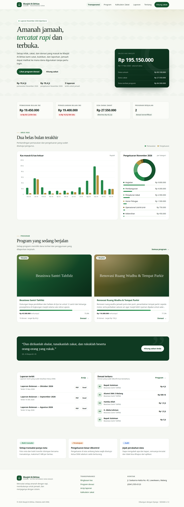
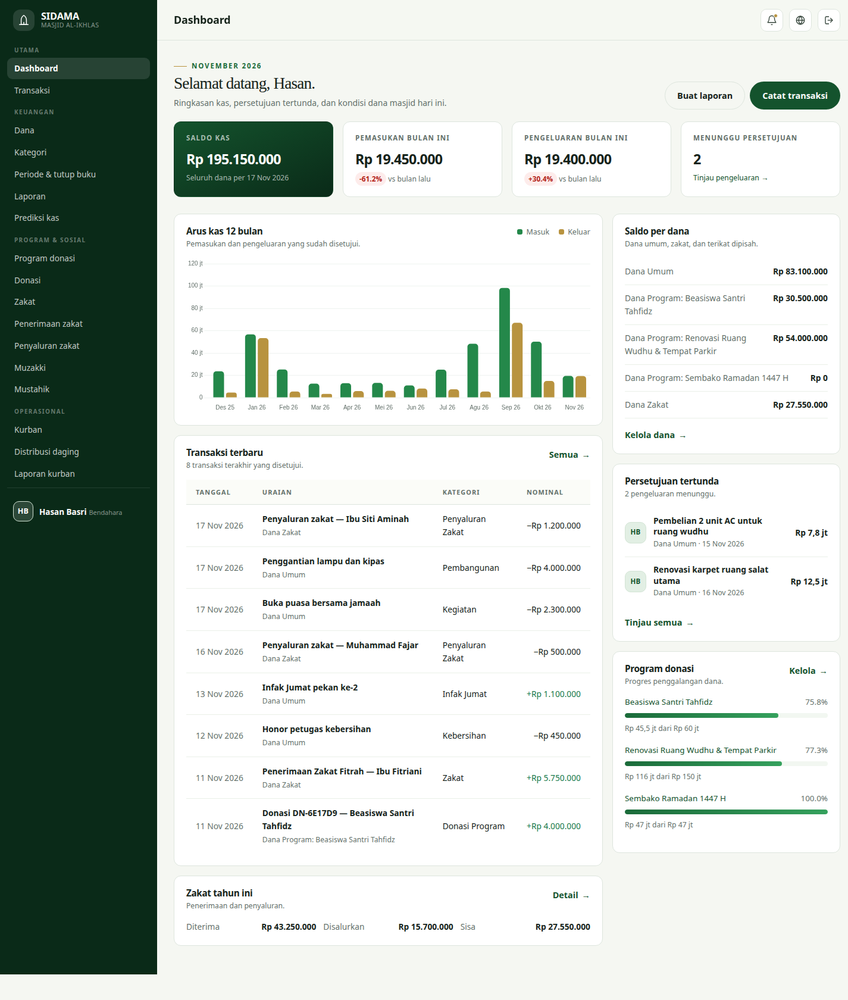
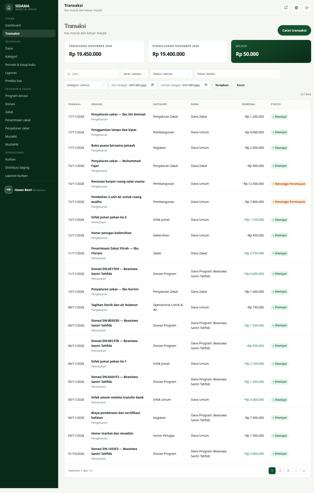
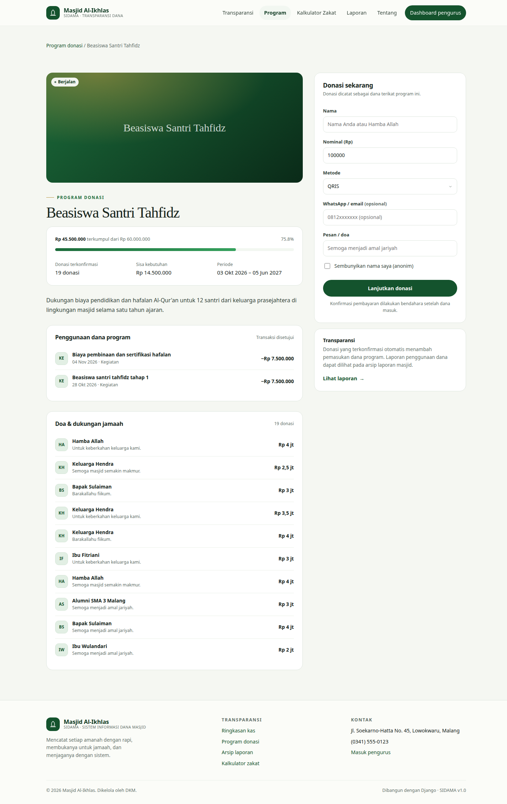
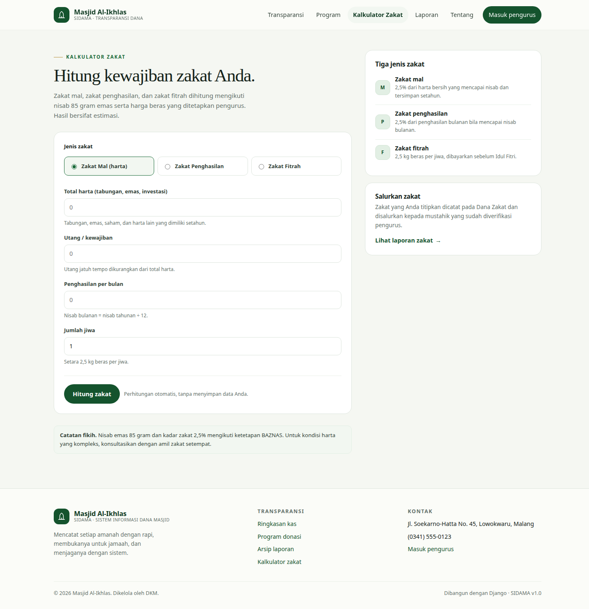
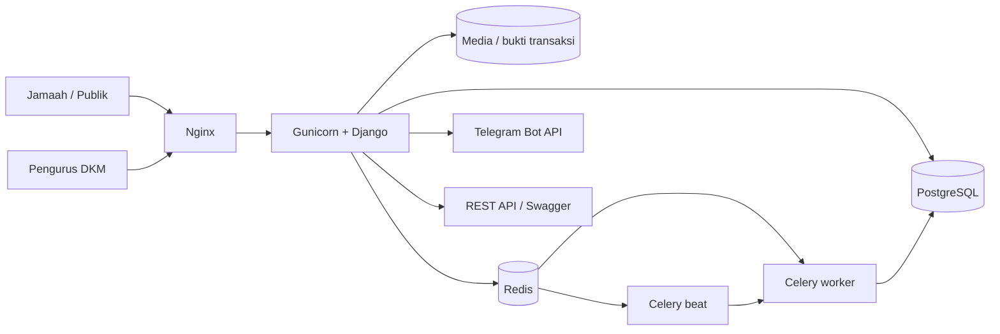
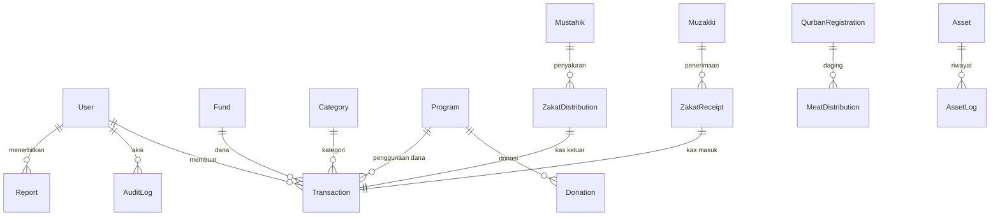

# SIDAMA — Sistem Informasi Dana Masjid

Aplikasi web untuk mencatat, mengelola, dan **mentransparansikan keuangan masjid**.
Dibangun dengan Django + Django REST Framework, dilengkapi halaman publik tanpa login,
persetujuan pengeluaran, audit log, laporan PDF/Excel otomatis, serta prediksi kas.



[](https://github.com/iqbaal24/sidama/actions/workflows/ci.yml)
[](https://render.com/deploy?repo=https://github.com/iqbaal24/sidama)

> **Demo:** jalankan lokal dengan `seed_demo` — tersedia 12 bulan data transaksi realistis,
> 3 program donasi, data zakat, kurban, aset, dan laporan yang sudah terbit.

---

## Daftar isi

- [Latar belakang](#latar-belakang)
- [Tangkapan layar](#tangkapan-layar)
- [Fitur](#fitur)
- [Arsitektur](#arsitektur)
- [Model data](#model-data)
- [Menjalankan di lokal](#menjalankan-di-lokal)
- [Akun demo](#akun-demo)
- [Data demo](#data-demo)
- [API](#api)
- [Pengujian](#pengujian)
- [Menjalankan dengan Docker](#menjalankan-dengan-docker)
- [Struktur proyek](#struktur-proyek)
- [Keputusan teknis](#keputusan-teknis)
- [Keamanan & privasi](#keamanan--privasi)
- [Batasan](#batasan)

---

## Latar belakang

Banyak masjid masih mencatat keuangan secara manual. Akibatnya laporan lambat dibuat,
jamaah sulit melihat penggunaan dana, bukti transaksi mudah hilang, dan tidak ada jejak
siapa mengubah data apa. SIDAMA menjawab masalah tersebut dengan:

1. Pencatatan kas masuk/keluar yang rapi, berkategori, dan memiliki bukti.
2. Persetujuan Ketua DKM untuk pengeluaran di atas ambang batas.
3. Halaman transparansi publik yang ringan dan ramah ponsel.
4. Laporan bulanan/tahunan PDF & Excel yang dibuat otomatis.
5. Audit log untuk setiap perubahan data penting.

## Tangkapan layar

| Dashboard pengurus | Halaman transaksi |
|---|---|
|  |  |

| Detail program donasi | Kalkulator zakat publik |
|---|---|
|  |  |

> Tangkapan layar dashboard & transaksi di atas adalah tampilan internal untuk pengurus.
> Pada deploy demo, aplikasi berjalan dalam mode publik saja (`SIDAMA_PUBLIC_ONLY=1`)
> sehingga hanya halaman jamaah yang dapat diakses.

## Fitur

### Keuangan

- CRUD transaksi: tanggal, jenis, kategori, dana, nominal, deskripsi, penanggung jawab, bukti.
- Kategori pemasukan (infak Jumat, infak umum, zakat, wakaf, sedekah, donasi program)
  dan pengeluaran (operasional, honor, kegiatan, pembangunan, penyaluran zakat, lain-lain).
- Unggah bukti JPG/PNG/PDF maksimal 5 MB dengan validasi tipe dan ukuran berkas.
- Saldo otomatis dan **dipisah per dana**: dana umum, dana zakat, dana terikat program.
- Alur persetujuan: pengeluaran di atas ambang batas berstatus *Menunggu Persetujuan*
  sampai disetujui Ketua DKM; saldo baru berkurang setelah disetujui.
- Tutup buku per periode: transaksi terkunci, koreksi hanya melalui **transaksi pembalik**.
- Pencarian, filter (jenis, status, dana, kategori, rentang tanggal), dan paginasi.

### Transparansi publik (tanpa login)

- Ringkasan saldo kas, pemasukan/pengeluaran bulan berjalan, dan grafik 12 bulan.
- Rincian pengeluaran per kategori dan saldo per jenis dana.
- Daftar program donasi dengan progres, donasi terbaru, dan pesan/doa jamaah.
- Arsip laporan yang sudah disahkan Ketua DKM (PDF & Excel).
- Kalkulator zakat mal, penghasilan, dan fitrah.
- Formulir donasi (nama/anonim, nominal, QRIS/transfer/tunai) + halaman instruksi pembayaran.

### Program donasi

- CRUD program (judul, deskripsi, target, periode, gambar, publikasi).
- Setiap program memiliki dana terikat sendiri; donasi terkonfirmasi otomatis menjadi
  pemasukan dana program dan menambah progres.
- Konfirmasi/penolakan donasi oleh bendahara; donasi anonim tidak menampilkan nama.
- Program otomatis berstatus *Selesai* saat target tercapai.

### Zakat

- Kalkulator zakat mal (nisab 85 g emas), penghasilan (nisab bulanan), dan fitrah (2,5 kg beras/jiwa).
- Data muzakki, mustahik (8 asnaf) dengan verifikasi, penerimaan, dan penyaluran.
- Penerimaan/penyaluran otomatis dibukukan ke Dana Zakat sebagai kas masuk/keluar.
- Rekap zakat bulanan dan tahunan.

### Kurban, aset, dan operasional

- Pendaftaran shohibul kurban (hewan, jiwa, nominal, status bayar).
- Distribusi daging dengan kupon unik dan penandaan sudah menerima.
- Laporan kurban per tahun.
- Inventaris aset dengan kondisi, nilai, dan riwayat perawatan/peminjaman.

### Laporan, notifikasi, audit, prediksi

- Laporan bulanan/tahunan/program dalam **PDF (ReportLab)** dan **Excel (openpyxl)**.
- Penerbitan laporan oleh Ketua DKM; laporan terbit tampil di halaman publik.
- Laporan bulanan terjadwal via **Celery beat** (default: setiap tanggal 1 pukul 02.00).
- Notifikasi dalam aplikasi + integrasi **Telegram** opsional (dikirim asinkron via Celery).
- Audit log read-only: siapa, kapan, model apa, nilai lama → nilai baru, alamat IP.
- Prediksi kas bulan depan dari rata-rata 6 bulan terakhir + peringatan runway.

## Arsitektur



- **Django Templates** untuk halaman publik dan internal; CSS kustom tanpa build step.
- **Chart.js** dibundel lokal (tanpa CDN) agar demo tetap jalan offline.
- Tugas berat (laporan, notifikasi) dijalankan asinkron; pada mode pengembangan
  `CELERY_TASK_ALWAYS_EAGER=1` sehingga tetap berjalan tanpa worker.

Detail diagram: [`docs/architecture.md`](docs/architecture.md).

## Model data



Entitas utama: `User`, `Fund`, `Category`, `Transaction`, `Period`, `Program`, `Donation`,
`Muzakki`, `ZakatReceipt`, `Mustahik`, `ZakatDistribution`, `QurbanRegistration`,
`MeatDistribution`, `Asset`, `AssetLog`, `Report`, `AuditLog`, `Setting`, `Notification`.

ERD lengkap: [`docs/erd.md`](docs/erd.md).

## Menjalankan di lokal

Prasyarat: Python 3.11+ (dikembangkan pada Python 3.14), pip.

```bash
python -m venv .venv
source .venv/bin/activate
pip install -r requirements.txt

cp .env.example .env        # opsional; default SQLite + DEBUG
python manage.py migrate
python manage.py seed_demo  # data demo 12 bulan
python manage.py runserver
```

Buka:

- Halaman publik: <http://127.0.0.1:8000/>
- Dashboard pengurus: <http://127.0.0.1:8000/login/>
- Swagger API: <http://127.0.0.1:8000/api/docs/>

Membuat ulang data demo:

```bash
python manage.py seed_demo --reset
```

Membuat superuser tambahan:

```bash
python manage.py createsuperuser
```

## Akun demo

| Peran | Username | Email | Kata sandi |
|---|---|---|---|
| Admin Sistem | `admin` | admin@sidama.local | `sidama123` |
| Ketua DKM | `ketua` | ketua@sidama.local | `sidama123` |
| Bendahara | `bendahara` | bendahara@sidama.local | `sidama123` |
| Sekretaris / Petugas | `sekretaris` | sekretaris@sidama.local | `sidama123` |
| Donatur | `donatur` | donatur@sidama.local | `sidama123` |

Login menerima **email atau username**. Halaman `/admin/` dapat diakses akun `admin`.

## Data demo

`seed_demo` membuat:

- 227 transaksi dalam 12 bulan (infak Jumat mingguan, infak umum, sedekah, wakaf,
  honor, listrik/air, kebersihan, kegiatan, pembangunan).
- 2 pengeluaran besar berstatus *Menunggu Persetujuan* untuk mencoba alur approval.
- 1 periode lama yang sudah ditutup untuk mencoba transaksi terkunci & pembalik.
- 3 program donasi (renovasi, beasiswa tahfidz, sembako Ramadan) dengan 84 donasi.
- 8 muzakki, 10 mustahik (sebagian belum terverifikasi), penerimaan & penyaluran zakat.
- Pendaftaran kurban, distribusi daging, 12 aset dengan riwayat.
- 4 laporan bulanan (3 terbit di halaman publik, 1 draf).
- Notifikasi internal dan jadwal laporan bulanan Celery beat.

## API

Autentikasi memakai token DRF:

```bash
curl -X POST http://127.0.0.1:8000/api/auth/login/ \
  -H "Content-Type: application/json" \
  -d '{"username":"bendahara","password":"sidama123"}'
```

Gunakan header `Authorization: Token <token>` pada permintaan berikutnya.

| Metode | Endpoint | Keterangan |
|---|---|---|
| POST | `/api/auth/login/` | Login, mengembalikan token |
| GET | `/api/auth/me/` | Profil pengguna token |
| GET/POST | `/api/transactions/` | Daftar & buat transaksi |
| POST | `/api/transactions/{id}/approve/` | Setujui pengeluaran (Ketua/Admin) |
| POST | `/api/transactions/{id}/reject/` | Tolak pengeluaran |
| GET | `/api/funds/balance/` | Saldo per dana |
| GET/POST | `/api/programs/` | Program donasi |
| POST | `/api/programs/{slug}/donate/` | Donasi publik |
| POST | `/api/donations/{id}/confirm/` | Konfirmasi donasi |
| GET/POST | `/api/zakat/receipts/` | Penerimaan zakat |
| GET/POST | `/api/zakat/muzakki/`, `/api/zakat/mustahik/` | Data zakat |
| POST | `/api/zakat/distributions/` | Penyaluran zakat |
| GET | `/api/zakat/calculate/` | Kalkulator zakat publik |
| GET/POST | `/api/qurban/registrations/` | Pendaftaran kurban |
| GET/POST | `/api/assets/` | Inventaris aset |
| POST | `/api/reports/generate/` | Buat laporan |
| GET | `/api/public/summary/` | Ringkasan transparansi publik |
| GET | `/api/forecast/cashflow/` | Proyeksi kas |
| GET | `/api/audit-logs/` | Audit log (Admin/Ketua) |

Dokumentasi interaktif: `/api/docs/` · skema OpenAPI: `/api/schema/`.
Koleksi Postman: [`docs/SIDAMA.postman_collection.json`](docs/SIDAMA.postman_collection.json).

## Pengujian

```bash
python manage.py test tests -v 2
```

54 pengujian mencakup:

- perhitungan saldo & ringkasan bulanan,
- ambang batas persetujuan dan alur approve/reject,
- penguncian periode dan transaksi pembalik,
- audit log (nilai lama/baru),
- kalkulator zakat & pembukuan zakat,
- alur donasi sampai progres program,
- RBAC setiap peran, rate limiting login,
- pembuatan/penyajian laporan PDF & Excel,
- endpoint API dan validasi.

## Deploy ke hosting (Render / Railway / Fly.io)

Repo ini sudah siap dideploy tanpa konfigurasi tambahan. Tiga jalur, pilih satu:

### A. Render (gratis, tanpa kartu — tombol satu klik)

1. Buka <https://render.com/deploy?repo=https://github.com/iqbaal24/sidama>
   (atau login Render dengan GitHub, lalu **New → Blueprint** dan pilih repo `sidama`).
2. Render membaca [`render.yaml`](render.yaml): **satu** web service free, memakai SQLite
   (tidak ada database terkelola, jadi Render tidak meminta kartu).
   `build.sh` menjalankan collectstatic; `start.sh` menjalankan migrate → seed data demo →
   gunicorn setiap kali instance hidup.
3. Blueprint sudah menyetel `SIDAMA_PUBLIC_ONLY=1`, jadi yang tayang hanya situs jamaah.
4. Setelah selesai, aplikasi hidup di `https://sidama-xxxx.onrender.com`.

Catatan tier gratis Render: instance tidur setelah ~15 menit tanpa trafik (permintaan
pertama setelah tidur butuh ±30–50 detik). Karena SQLite berada di disk sementara, data
demo dibuat ulang otomatis saat boot; kalau ingin data awet melewati redeploy, set
`DATABASE_URL` dari [Neon](https://neon.tech) (gratis, tanpa kartu) di dashboard Render.

**Kalau Render tetap meminta kartu:** itu bukan tagihan, hanya verifikasi $1 yang
dikembalikan. Penyebab umumnya blueprint yang membuat lebih dari satu resource — pastikan
tidak ada database di `render.yaml`, lalu deploy ulang sebagai satu web service biasa
(**New → Web Service**, bukan Blueprint) dengan Build Command `./build.sh` dan Start
Command `./start.sh`.

### B. Railway

1. **New Project → Deploy from GitHub repo** → pilih `sidama`.
2. Railway mengisi `PORT` otomatis; `start.sh` memakai SQLite bila `DATABASE_URL` kosong.
3. Tambahkan plugin **PostgreSQL** bila ingin data persisten.
4. [`railway.json`](railway.json) sudah mengatur build & start command.

### C. Fly.io (butuh kartu terdaftar)

```bash
fly launch --copy-config --no-deploy   # memakai fly.toml
fly volumes create sidama_data --size 1
fly secrets set DJANGO_SECRET_KEY="$(openssl rand -base64 48)"
fly deploy
```

### Mode publik saja (tanpa dashboard internal)

Untuk demo portofolio, dashboard pengurus tidak perlu ikut tayang. Set satu variabel:

```
SIDAMA_PUBLIC_ONLY=1
```

Efeknya:

- Hanya halaman jamaah yang didaftarkan: beranda transparansi, daftar & detail program,
  formulir donasi, status donasi, kalkulator zakat, arsip laporan, tentang, `/healthz/`.
- `/login/`, `/app/...`, `/admin/`, `/profil/` dan endpoint API terautentikasi
  **tidak dimount sama sekali** → 404, bukan halaman login.
- Tombol “Masuk pengurus” di header dan footer otomatis hilang.
- `SIDAMA_DEMO_AUTO_CONFIRM=1` (default mengikuti mode publik) membuat donasi langsung
  terkonfirmasi saat dikirim, sehingga progres program dan “Donasi terbaru” bergerak —
  tanpa perlu akun bendahara.

Untuk masjid sungguhan, matikan keduanya (`SIDAMA_PUBLIC_ONLY=0`) agar dashboard dan
alur persetujuan aktif kembali.

Verifikasi lokal:

```bash
SIDAMA_PUBLIC_ONLY=1 DJANGO_DEBUG=0 DJANGO_SECRET_KEY=x \
  .venv/bin/gunicorn config.wsgi:application --bind 127.0.0.1:8021
```

### Variabel lingkungan yang dipakai

| Variabel | Wajib | Keterangan |
|---|---|---|
| `DJANGO_SECRET_KEY` | produksi | Kunci acak panjang; `generateValue` di Render |
| `DJANGO_DEBUG` | – | `0` untuk produksi |
| `DJANGO_ALLOWED_HOSTS` | – | Host tambahan, dipisah koma; host platform terdeteksi otomatis |
| `DATABASE_URL` | – | Diisi otomatis oleh Render/Railway/Heroku |
| `SIDAMA_PUBLIC_ONLY` | – | `1` = hanya halaman publik, dashboard & admin tidak dimount |
| `SIDAMA_DEMO_AUTO_CONFIRM` | – | `1` = donasi publik langsung terkonfirmasi (mode demo) |
| `CELERY_BROKER_URL` | – | Isi `disabled` bila tanpa Redis → tugas jalan inline |
| `DJANGO_SECURE_SSL_REDIRECT` | – | `1` di produksi (default) |

Verifikasi lokal dengan mode produksi (tanpa Redis, DEBUG=0):

```bash
DJANGO_DEBUG=0 DJANGO_SECRET_KEY=x .venv/bin/python manage.py collectstatic --noinput
DJANGO_DEBUG=0 DJANGO_SECRET_KEY=x gunicorn config.wsgi:application --bind 127.0.0.1:8020
```

## Menjalankan dengan Docker

```bash
cp .env.example .env   # opsional, ubah DJANGO_SECRET_KEY
docker compose up --build -d
docker compose exec web python manage.py seed_demo
```

- Aplikasi: <http://localhost:8080>
- Postgres, Redis, web (Gunicorn), worker, beat, dan Nginx dijalankan sebagai service.
- Berkas statis dikumpulkan otomatis oleh entrypoint dan disajikan Nginx.

Untuk produksi: set `DJANGO_DEBUG=0`, `DJANGO_SECRET_KEY` acak, `DJANGO_ALLOWED_HOSTS`,
dan `DJANGO_CSRF_TRUSTED_ORIGINS` sesuai domain, serta aktifkan HTTPS di depan Nginx.

## Struktur proyek

```
sidama/
├── config/                 # settings, urls, celery
├── apps/
│   ├── core/               # pengaturan, dashboard, komponen bersama, seed_demo
│   ├── accounts/           # pengguna, peran, autentikasi
│   ├── audit/              # audit log & signal perubahan data
│   ├── finance/            # dana, kategori, transaksi, persetujuan, periode
│   ├── programs/           # program donasi & donasi
│   ├── zakat/              # muzakki, mustahik, penerimaan, penyaluran, kalkulator
│   ├── qurban/             # pendaftaran kurban & distribusi daging
│   ├── assets/             # inventaris aset
│   ├── reports/            # generator PDF/Excel, penerbitan, jadwal
│   ├── notifications/      # notifikasi internal & Telegram
│   ├── forecasting/        # prediksi kas
│   ├── public/             # halaman transparansi publik
│   └── api/                # serializer, viewset, permission DRF
├── templates/              # publik, internal, auth
├── static/                 # CSS kustom, JS, Chart.js lokal
├── tests/                  # 54 pengujian
├── docker/                 # entrypoint & konfigurasi Nginx
├── docs/                   # arsitektur, ERD, Postman, tangkapan layar
├── Dockerfile
├── docker-compose.yml
├── requirements.txt
└── manage.py
```

## Keputusan teknis

- **Dana sebagai entitas terpisah.** Saldo tidak disimpan sebagai kolom, melainkan dihitung
  dari transaksi `approved`. Ini menghindari saldo “nyasar” saat approval atau pembalik.
- **Persetujuan di level transaksi.** Pengeluaran besar tidak mengurangi saldo sampai
  disetujui; penolakan tetap tercatat pada audit log.
- **Tutup buku + transaksi pembalik.** Data historis tidak dihapus/diubah; koreksi dibuat
  sebagai entri berlawanan agar jejak audit utuh.
- **Audit via signal + thread-local user.** Perubahan model penting tercatat otomatis
  (nilai lama/baru, pengguna, IP) tanpa harus menulis log manual di setiap view.
- **Donasi program menjadi dana terikat.** Setiap program mendapat `Fund` sendiri sehingga
  penggunaan dananya tidak bercampur dengan dana umum.
- **SQLite untuk pengembangan, PostgreSQL untuk produksi.** Konfigurasi database dipilih
  lewat `DB_ENGINE`; CI menguji dengan PostgreSQL.
- **Celery opsional di lokal.** `CELERY_TASK_ALWAYS_EAGER` membuat laporan dan notifikasi
  tetap berjalan tanpa Redis saat demo.
- **Chart.js dibundel lokal.** Halaman publik tetap tampil saat koneksi terbatas.

## Keamanan & privasi

- Hash kata sandi Django (PBKDF2), proteksi CSRF/XSS, query melalui ORM.
- RBAC di setiap view dan endpoint; pengujian peran tersedia.
- Rate limiting login 5 percobaan / 5 menit per IP+identitas.
- Validasi ekstensi, MIME, dan ukuran unggahan; nama berkas mengikuti path tanggal.
- Data mustahik dan kontak donatur tidak ditampilkan di halaman publik; opsi donasi anonim.
- Audit log hanya-baca; tidak tersedia tombol hapus di UI maupun admin.
- Produksi: HTTPS, secure cookies, HSTS, `DEBUG=False` (lihat `config/settings.py`).

## Batasan

- Pembayaran tidak diproses langsung; konfirmasi donasi dilakukan manual oleh bendahara.
- Bukan aplikasi akuntansi penuh (tanpa jurnal debit-kredit/neraca formal).
- Satu instalasi untuk satu masjid (belum multi-tenant).
- Notifikasi WhatsApp belum diimplementasikan (baru Telegram + notifikasi internal).
- Gambar program pada data demo memakai placeholder gradien, bukan foto asli.

## Lisensi

Proyek portofolio. Silakan gunakan dan modifikasi untuk kebutuhan masjid.
