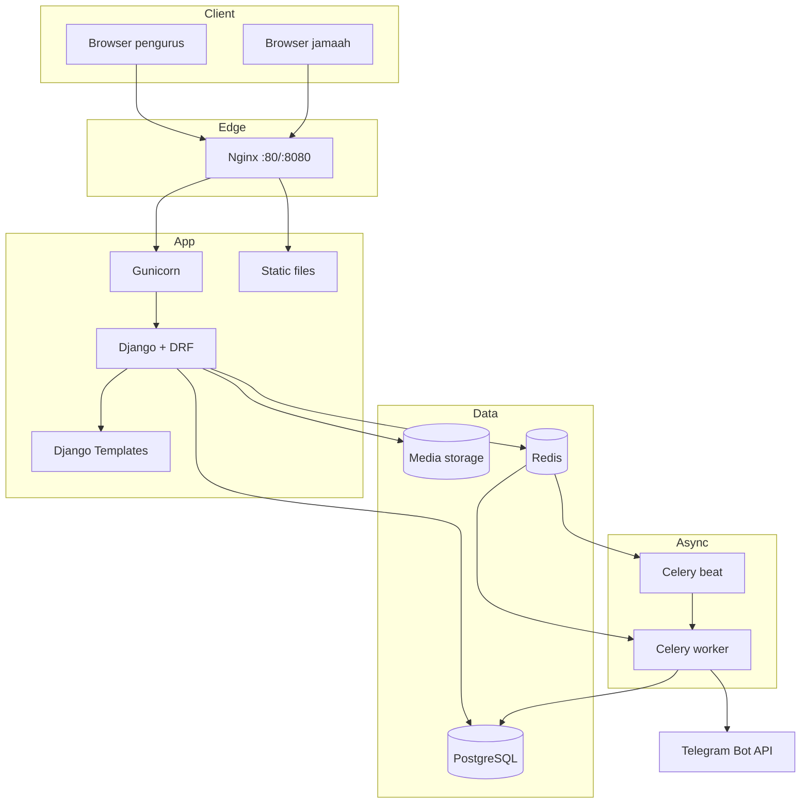
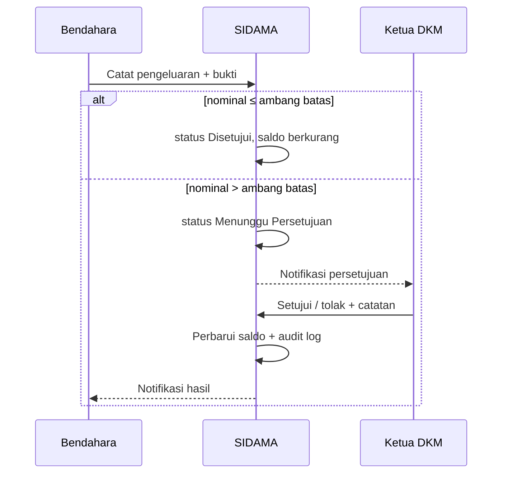
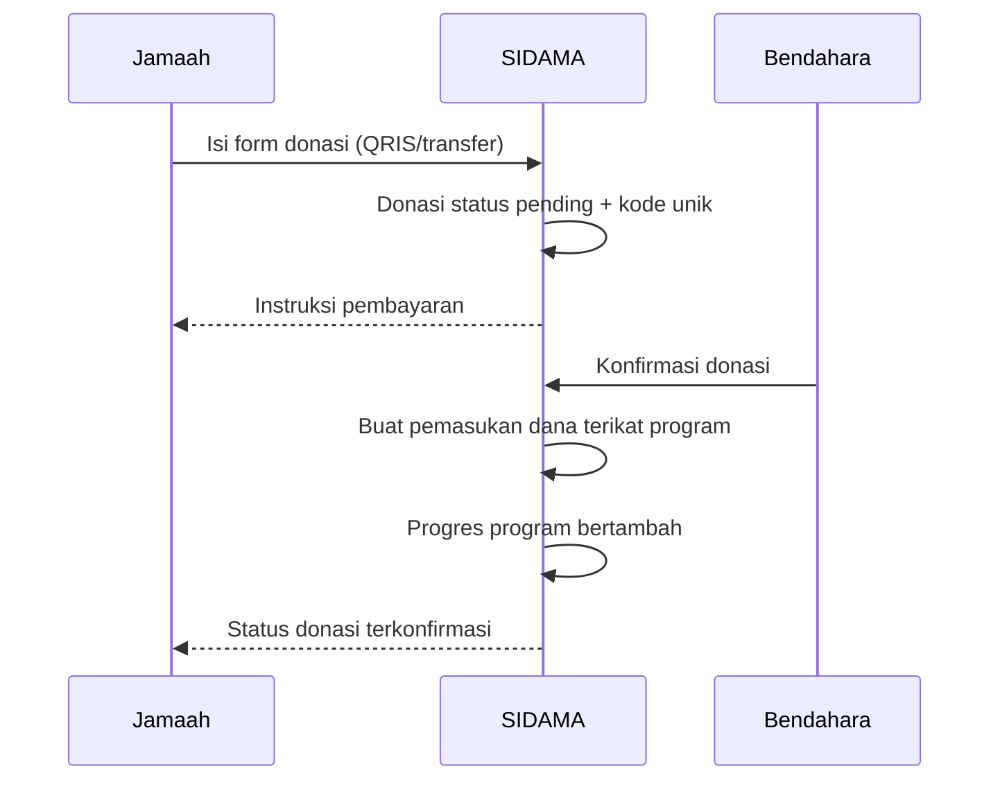
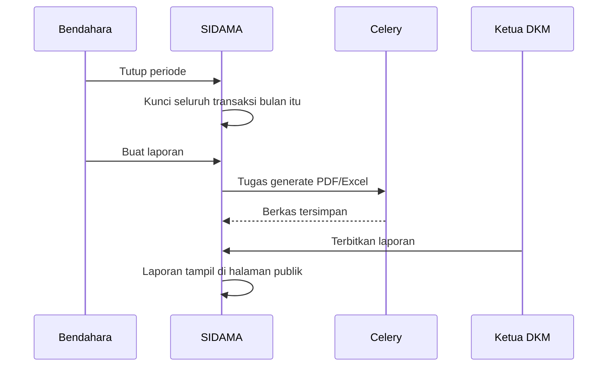

# Arsitektur SIDAMA

## Ringkasan

SIDAMA adalah aplikasi monolit Django dengan pemisahan tugas per app. Halaman publik dan
internal memakai Django Templates; integrasi eksternal (Telegram) dan tugas berat
(laporan, notifikasi) dijalankan melalui Celery.

## Alur utama

### 1. Pencatatan pengeluaran dengan persetujuan

### 2. Donasi program

### 3. Tutup buku dan laporan

## Modul dan tanggung jawab

| App | Tanggung jawab |
|---|---|
| `core` | Pengaturan berbasis database, dashboard, komponen list/form bersama, `seed_demo` |
| `accounts` | User kustom, peran (admin/ketua/bendahara/petugas/donatur), login email/username |
| `audit` | Model audit, middleware konteks request, signal perubahan data |
| `finance` | Dana, kategori, transaksi, persetujuan, periode/tutup buku |
| `programs` | Program donasi, donasi, konfirmasi → dana terikat |
| `zakat` | Muzakki, mustahik, penerimaan, penyaluran, kalkulator |
| `qurban` | Pendaftaran kurban, distribusi daging, laporan |
| `assets` | Inventaris dan riwayat aset |
| `reports` | Generator PDF/Excel, penerbitan, jadwal Celery |
| `notifications` | Notifikasi internal, transport Telegram |
| `forecasting` | Proyeksi kas dari rata-rata historis |
| `public` | Halaman transparansi, program, zakat, laporan |
| `api` | Serializer, viewset, permission, skema OpenAPI |

## Keputusan desain

- **Saldo dihitung, bukan disimpan.** `fund_balance()` mengagregasi transaksi berstatus
  `approved`; tidak ada risiko saldo ganda saat approval/pembalik.
- **Dana terikat per program.** `Program.fund` dibuat otomatis saat donasi pertama
  dikonfirmasi, sehingga laporan per program bersih.
- **Audit tidak dapat dihapus.** Model hanya dibaca lewat UI; admin Django dibuat read-only.
- **Pemisahan tugas.** Semua query lintas modul berada di `services.py` agar view dan API
  memakai aturan yang sama.
- **Idempoten.** Konfirmasi donasi dan pembukuan zakat tidak membuat transaksi ganda.
