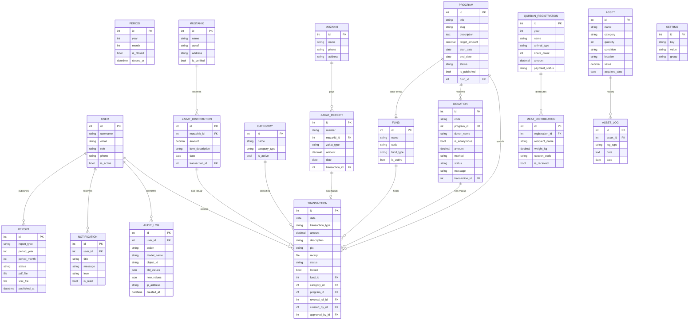

# ERD SIDAMA

## Catatan

- `Transaction.program` opsional; hanya dipakai untuk pengeluaran yang menggunakan dana program.
- `Transaction.reversal_of` menunjuk transaksi asal saat koreksi periode tertutup.
- `Donation.transaction`, `ZakatReceipt.transaction`, dan `ZakatDistribution.transaction`
  adalah relasi satu-ke-satu agar tidak ada pembukuan ganda.
- `Period` unik per `(year, month)`; penutupan mengunci transaksi pada rentang tanggal tersebut.
